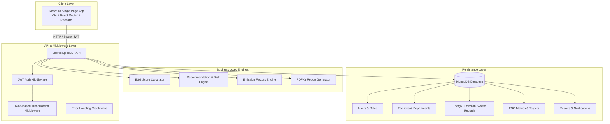

# ESG Sustainability Performance Monitoring & Reporting Platform

A full-stack, enterprise-grade **ESG (Environmental, Social, and Governance) Sustainability Performance Monitoring & Reporting Platform**. This application enables organizations to track environmental footprints (carbon emissions, energy consumption, waste diversion), monitor social and governance KPIs, establish sustainability targets, generate risk recommendations, and export executive PDF compliance reports.

---

## Table of Contents

1. [Executive Summary](#1-executive-summary)
2. [System Architecture](#2-system-architecture)
3. [Technology Stack](#3-technology-stack)
4. [Role-Based Access Control (RBAC)](#4-role-based-access-control-rbac)
5. [Database Models & Data Dictionary](#5-database-models--data-dictionary)
6. [Methodology & Computational Formulas](#6-methodology--computational-formulas)
   - [ESG Score Algorithm](#esg-score-algorithm)
   - [Carbon Emission Conversions & Factors](#carbon-emission-conversions--factors)
   - [Target Progress & Status Computation](#target-progress--status-computation)
   - [Automated Risk & Recommendation Engine](#automated-risk--recommendation-engine)
7. [Comprehensive REST API Reference](#7-comprehensive-rest-api-reference)
8. [Frontend Features & User Interfaces](#8-frontend-features--user-interfaces)
9. [Installation, Configuration & Setup](#9-installation-configuration--setup)
10. [Demo Credentials](#10-demo-credentials)

---

## 1. Executive Summary

Corporate ESG compliance requires granular tracking across operations, facilities, and departments. This platform provides:
- **Environmental Tracking**: Energy (electricity, fuel, water, renewables), greenhouse gas emissions across multiple fuel and utility sources, and comprehensive waste streams (recycling, reuse, disposal).
- **ESG Scorecard (0–100 Scale)**: Weighted multi-pillar scoring methodology (40% Environmental, 30% Social, 30% Governance) with target benchmark ratios.
- **Goal Setting & Target Tracking**: Real-time progress monitoring with automated status detection (`On Track`, `At Risk`, `Achieved`, `Overdue`).
- **Rule-Based Risk & Recommendation Engine**: Automated detection of emission spikes, sub-target recycling rates, and overdue initiatives paired with mitigation recommendations.
- **Executive PDF Reporting**: Direct server-side compilation of compliance summaries and audit snapshots via PDFKit.
- **Audit & Governance**: Multi-role security, department-level scoping, and user management.

---

## 2. System Architecture



---

## 3. Technology Stack

### Backend
- **Runtime**: Node.js (CommonJS modules)
- **Web Framework**: Express.js (`4.19.2`)
- **Database**: MongoDB via Mongoose ODM (`8.5.0`)
- **Authentication**: JSON Web Tokens (`jsonwebtoken 9.0.2`), password hashing via `bcryptjs (2.4.3)`
- **PDF Generation**: `pdfkit (0.15.0)` for streaming vector PDF reports
- **Logging & Utilities**: `morgan` (HTTP request logging), `cors`, `dotenv`, `validator`, `express-async-handler`

### Frontend
- **Framework**: React 18 (`18.3.1`)
- **Build Tool**: Vite (`5.3.4`) with `@vitejs/plugin-react`
- **Routing**: React Router DOM (`v6.24.1`)
- **Data Visualization**: Recharts (`v2.12.7`) for interactive bar, area, and pie charts
- **HTTP Client**: Axios (`1.7.2`) with global request/response interceptors and automatic token attachment
- **Design System**: Vanilla CSS tokens (no heavy external CSS frameworks), responsive flexbox and CSS Grid layout, cohesive modern color palette, clean cards, and responsive modals.

---

## 4. Role-Based Access Control (RBAC)

The system enforces three distinct user roles:

| Role | Permissions | Access Scope |
| :--- | :--- | :--- |
| **`admin`** | Full platform control | User management, Facility/Department setup, Metric creation, Record creation/deletion, Report generation, System notification scan. |
| **`esg_manager`** | Operational ESG administration | Record creation/editing (Energy, Emissions, Waste), Target & Metric management, Report generation, viewing risks & dashboards. |
| **`employee`** | Operational visibility | View dashboards, view operational metrics, view company targets, receive notifications, update own profile. |

---

## 5. Database Models & Data Dictionary

### 5.1. `User`
Stores system accounts and credentials.
- `name` (String, required)
- `email` (String, required, unique, lowercase)
- `password` (String, required, min length 6, hashed with bcrypt)
- `role` (String, enum: `admin`, `esg_manager`, `employee`, default: `employee`)
- `department` (ObjectId, ref: `Department`)
- `facility` (ObjectId, ref: `Facility`)
- `isActive` (Boolean, default: `true`)
- `lastLogin` (Date)

### 5.2. `Facility` & `Department`
Organizes operational data by physical plant or company department.
- **Facility**: `name` (String, unique), `location` (String), `type` (String, e.g. "Office", "Plant")
- **Department**: `name` (String, unique), `description` (String), `facility` (ObjectId, ref: `Facility`)

### 5.3. `EnergyRecord`
Captures facility utility readings over monthly or specified intervals.
- `facility` (ObjectId, ref: `Facility`, required)
- `department` (ObjectId, ref: `Department`, required)
- `date` (Date, required)
- `electricityConsumption` (Number, kWh, required)
- `renewableEnergy` (Number, kWh, required, default: 0)
- `fuelConsumption` (Number, litres, required, default: 0)
- `waterConsumption` (Number, KL, required, default: 0)
- `unit` (String, default: `"kWh"`)
- **Virtuals**:
  - `totalEnergy`: `electricityConsumption + fuelConsumption`
  - `renewablePercentage`: `(renewableEnergy / electricityConsumption) * 100`

### 5.4. `EmissionRecord`
Captures direct and indirect greenhouse gas emissions with automatic $\text{CO}_2\text{e}$ resolution.
- `facility` (ObjectId, ref: `Facility`, required)
- `department` (ObjectId, ref: `Department`, required)
- `source` (String, enum: `Electricity`, `Petrol`, `Diesel`, `NaturalGas`, `Transportation`, `Other`, required)
- `quantity` (Number, required)
- `unit` (String, e.g. `"litres"`, `"kWh"`, `"m3"`, `"km"`)
- `emissionFactor` (Number, kg $\text{CO}_2\text{e}$ per unit)
- `co2e` (Number, automatically calculated on pre-save: `quantity * emissionFactor`)
- `date` (Date, required)

### 5.5. `WasteRecord`
Monitors materials disposal, reuse, and recycling diversion.
- `facility` (ObjectId, ref: `Facility`, required)
- `department` (ObjectId, ref: `Department`, required)
- `wasteType` (String, enum: `Plastic`, `Paper`, `FoodWaste`, `EWaste`, `Metal`, `General`, required)
- `quantity` (Number, kg, required)
- `recycledQuantity` (Number, kg, default: 0)
- `reusedQuantity` (Number, kg, default: 0)
- `disposedQuantity` (Number, kg, default: 0)
- `date` (Date, required)

### 5.6. `EsgMetric`
Pillar-level metrics against defined organizational thresholds.
- `name` (String, required, e.g. "Carbon Emissions", "Employee Training Hours", "Compliance Rate")
- `category` (String, enum: `Environmental`, `Social`, `Governance`, required)
- `value` (Number, required)
- `target` (Number, required)
- `unit` (String, e.g. `"tCO2e"`, `"kWh"`, `"%"`, `"hrs"`, `"count"`)
- `date` (Date, required)
- `department` (ObjectId, ref: `Department`)

### 5.7. `Target`
Strategic sustainability goals with automated trajectory status.
- `name` (String, required)
- `category` (String, enum: `Environmental`, `Social`, `Governance`, required)
- `currentValue` (Number, required)
- `targetValue` (Number, required)
- `unit` (String)
- `deadline` (Date, required)
- `direction` (String, enum: `increase`, `decrease`, default: `increase`)
- `status` (String, enum: `On Track`, `At Risk`, `Achieved`, `Overdue`)
- **Instance Method**: `computeStatus()` dynamically evaluates percentage and status based on trajectory and deadline.

### 5.8. `Report`
Stores historical snapshots of compliance reports and summaries.
- `title` (String, required)
- `periodType` (String, enum: `monthly`, `yearly`, required)
- `periodStart` (Date, required)
- `periodEnd` (Date, required)
- `snapshot` (Mixed, JSON summary of energy, emissions, waste, ESG score, targets, and risks)
- `generatedBy` (ObjectId, ref: `User`)

### 5.9. `Notification`
Audit events, deadline alerts, and variance warnings.
- `type` (String, enum: `TargetNearingDeadline`, `TargetOverdue`, `MetricBelowTarget`, `EmissionsIncreasing`, `RecyclingBelowTarget`)
- `message` (String, required)
- `severity` (String, enum: `info`, `warning`, `critical`, default: `info`)
- `relatedTo` (ObjectId, polymorphic reference)
- `relatedModel` (String, enum: `Target`, `EsgMetric`, `EmissionRecord`, `WasteRecord`)
- `isRead` (Boolean, default: `false`)
- `recipientRole` (String, enum: `admin`, `esg_manager`, `employee`, `all`, default: `all`)

---

## 6. Methodology & Computational Formulas

### ESG Score Algorithm
The platform computes a standardized **0–100 ESG Score**:
1. **Metric Ratio**:
   - For **"Higher is better"** metrics (e.g. Renewable %, Diversity, Training Hours):
     $$\text{Ratio} = \min\left(\frac{\text{Value}}{\text{Target}}, 1.20\right)$$
   - For **"Lower is better"** metrics (e.g. Emissions, Violations, Safety Incidents):
     $$\text{Ratio} = \text{if Value} = 0 \text{ then } 1.20 \text{ else } \min\left(\frac{\text{Target}}{\text{Value}}, 1.20\right)$$
2. **Metric Score**:
   $$\text{Score}_{\text{metric}} = \min(100, \text{Ratio} \times 100)$$
3. **Pillar Score**:
   Average of all metric scores in that pillar ($S_{\text{Env}}$, $S_{\text{Soc}}$, $S_{\text{Gov}}$).
4. **Overall Score**:
   $$\text{ESG Overall} = (0.40 \times S_{\text{Env}}) + (0.30 \times S_{\text{Soc}}) + (0.30 \times S_{\text{Gov}})$$

### Carbon Emission Conversions & Factors
Calculated as:
$$\text{CO}_2\text{e (kg)} = \text{Quantity} \times \text{Emission Factor}$$

Reference default factors:
- **Electricity**: `0.82 kg CO2e / kWh` (Grid average)
- **Petrol**: `2.31 kg CO2e / litre`
- **Diesel**: `2.68 kg CO2e / litre`
- **Natural Gas**: `2.02 kg CO2e / m³`
- **Transportation**: `0.14 kg CO2e / km`
- **Other**: `1.00 kg CO2e / unit`

### Target Progress & Status Computation
- For **Increase** goals:
  $$\text{Progress} = \left(\frac{\text{Current Value}}{\text{Target Value}}\right) \times 100$$
- For **Decrease** goals:
  $$\text{Progress} = \left(\frac{\text{Baseline} - \text{Current Value}}{\text{Baseline} - \text{Target Value}}\right) \times 100$$
- **Status Classification**:
  - `Achieved`: $\text{Progress} \ge 100\%$
  - `Overdue`: Current date $>$ Deadline and $\text{Progress} < 100\%$
  - `At Risk`: Current date $\le$ Deadline and $\text{Progress} < 50\%$
  - `On Track`: Current date $\le$ Deadline and $\text{Progress} \ge 50\%$

### Automated Risk & Recommendation Engine
The platform performs rule-based periodic risk analysis comparing current vs. previous month metrics:
1. **Emissions Spike**: If emissions increase by $>10\%$ month-over-month (marked `warning`) or $>25\%$ (marked `critical`).
2. **Recycling Deficit**: If overall recycling rate falls below $50\%$ (`warning`) or below $30\%$ (`critical`).
3. **Energy Surge**: If total energy usage jumps by $>10\%$ (`warning`) or $>25\%$ (`critical`).
4. **Target Delinquency**: Any target flagged as `At Risk` or `Overdue` triggers actionable mitigation recommendations.

---

## 7. Comprehensive REST API Reference

Base URL: `http://localhost:5000/api`

### 7.1. Authentication (`/auth`)
| Method | Endpoint | Access | Description |
| :--- | :--- | :--- | :--- |
| `POST` | `/auth/register` | Public | Register new user account |
| `POST` | `/auth/login` | Public | Authenticate user & receive JWT token |
| `GET` | `/auth/me` | Authenticated | Retrieve authenticated user profile |
| `PUT` | `/auth/me` | Authenticated | Update current user name or password |

### 7.2. Dashboard & Analytics (`/dashboard`)
| Method | Endpoint | Access | Description |
| :--- | :--- | :--- | :--- |
| `GET` | `/dashboard/summary` | Authenticated | Total aggregates, ESG scores, and chart series (filtered by facility/dept/date) |
| `GET` | `/dashboard/risks` | Authenticated | Run risk engine and retrieve active risks and recommendations |

### 7.3. Energy Records (`/energy`)
| Method | Endpoint | Access | Description |
| :--- | :--- | :--- | :--- |
| `GET` | `/energy` | Authenticated | List all energy records with filter options |
| `GET` | `/energy/summary` | Authenticated | Aggregate electricity, renewable %, fuel, and water stats |
| `GET` | `/energy/:id` | Authenticated | Fetch specific energy record |
| `POST` | `/energy` | Admin / ESG Mgr | Create new energy reading |
| `PUT` | `/energy/:id` | Admin / ESG Mgr | Update existing energy reading |
| `DELETE` | `/energy/:id` | Admin / ESG Mgr | Delete energy reading |

### 7.4. Emissions Records (`/emissions`)
| Method | Endpoint | Access | Description |
| :--- | :--- | :--- | :--- |
| `GET` | `/emissions` | Authenticated | List emission records |
| `GET` | `/emissions/summary` | Authenticated | Total estimated CO2e and breakdown by fuel/source |
| `GET` | `/emissions/:id` | Authenticated | Fetch specific emission entry |
| `POST` | `/emissions` | Admin / ESG Mgr | Log emissions (auto-calculates CO2e) |
| `PUT` | `/emissions/:id` | Admin / ESG Mgr | Update emission entry |
| `DELETE` | `/emissions/:id` | Admin / ESG Mgr | Delete emission entry |

### 7.5. Waste Records (`/waste`)
| Method | Endpoint | Access | Description |
| :--- | :--- | :--- | :--- |
| `GET` | `/waste` | Authenticated | List waste records |
| `GET` | `/waste/summary` | Authenticated | Total waste, recycled/reused/disposed rates, type breakdown |
| `GET` | `/waste/:id` | Authenticated | Fetch specific waste record |
| `POST` | `/waste` | Admin / ESG Mgr | Log new waste record |
| `PUT` | `/waste/:id` | Admin / ESG Mgr | Update waste record |
| `DELETE` | `/waste/:id` | Admin / ESG Mgr | Delete waste record |

### 7.6. ESG Metrics & Scoring (`/metrics`)
| Method | Endpoint | Access | Description |
| :--- | :--- | :--- | :--- |
| `GET` | `/metrics` | Authenticated | List ESG metrics across E, S, and G categories |
| `GET` | `/metrics/score` | Authenticated | Retrieve calculated category & overall ESG scores with methodology |
| `GET` | `/metrics/:id` | Authenticated | Fetch single metric |
| `POST` | `/metrics` | Admin / ESG Mgr | Add new ESG KPI metric |
| `PUT` | `/metrics/:id` | Admin / ESG Mgr | Update metric value or target |
| `DELETE` | `/metrics/:id` | Admin / ESG Mgr | Delete ESG metric |

### 7.7. Sustainability Targets (`/targets`)
| Method | Endpoint | Access | Description |
| :--- | :--- | :--- | :--- |
| `GET` | `/targets` | Authenticated | List all targets with dynamic computed progress & status |
| `GET` | `/targets/:id` | Authenticated | Fetch single target |
| `POST` | `/targets` | Admin / ESG Mgr | Create sustainability target |
| `PUT` | `/targets/:id` | Admin / ESG Mgr | Update target values or deadlines |
| `DELETE` | `/targets/:id` | Admin / ESG Mgr | Delete sustainability target |

### 7.8. Reports & PDF Export (`/reports`)
| Method | Endpoint | Access | Description |
| :--- | :--- | :--- | :--- |
| `GET` | `/reports` | Authenticated | List generated report snapshots |
| `GET` | `/reports/:id` | Authenticated | Retrieve report snapshot details |
| `POST` | `/reports` | Admin / ESG Mgr | Generate new point-in-time compliance report |
| `GET` | `/reports/:id/pdf` | Authenticated | Stream compiled executive PDF report |
| `DELETE` | `/reports/:id` | Admin / ESG Mgr | Remove report snapshot |

### 7.9. Organizational Structure (`/org`)
| Method | Endpoint | Access | Description |
| :--- | :--- | :--- | :--- |
| `GET` | `/org/departments` | Authenticated | List all departments |
| `POST` | `/org/departments` | Admin Only | Create department |
| `PUT` | `/org/departments/:id`| Admin Only | Update department |
| `DELETE`| `/org/departments/:id`| Admin Only | Delete department |
| `GET` | `/org/facilities` | Authenticated | List all facilities |
| `POST` | `/org/facilities` | Admin Only | Create facility |
| `PUT` | `/org/facilities/:id` | Admin Only | Update facility |
| `DELETE`| `/org/facilities/:id` | Admin Only | Delete facility |

### 7.10. User Administration (`/users`)
| Method | Endpoint | Access | Description |
| :--- | :--- | :--- | :--- |
| `GET` | `/users` | Admin Only | List all registered users |
| `GET` | `/users/:id` | Admin Only | View single user |
| `POST` | `/users` | Admin Only | Provision new user account |
| `PUT` | `/users/:id` | Admin Only | Update role, facility, or active state |
| `DELETE` | `/users/:id` | Admin Only | Delete user account |

### 7.11. Notifications (`/notifications`)
| Method | Endpoint | Access | Description |
| :--- | :--- | :--- | :--- |
| `GET` | `/notifications` | Authenticated | Fetch user-scoped notifications |
| `PUT` | `/notifications/:id/read` | Authenticated | Mark notification as read |
| `POST` | `/notifications/generate` | Admin / ESG Mgr | Trigger instant scan for overdue/at-risk items |

---

## 8. Frontend Features & User Interfaces

1. **Executive Dashboard (`/dashboard`)**:
   - High-level KPI cards: Overall ESG score, total emissions, total energy, renewable %, and waste recycling rate.
   - ESG Pillar breakdown cards (Environmental, Social, Governance).
   - Recharts visual graphs: Emissions over time, Energy over time, Waste breakdown by type, Renewable vs Non-renewable mix.
   - Target status overview and active risk alerts banner.
2. **Environmental Tracking Pages (`/energy`, `/emissions`, `/waste`)**:
   - Interactive data tables with sorting and facility filtering.
   - Dynamic modal dialogs for logging readings.
   - Breakdown charts and stat counters.
3. **ESG Metrics Manager (`/metrics`)**:
   - Filterable catalog of Environmental, Social, and Governance metrics.
   - Target vs. Actual comparisons and achievement calculations.
4. **Targets & Goals Tracker (`/targets`)**:
   - Visual progress bars with status badges (`On Track`, `At Risk`, `Achieved`, `Overdue`).
   - Deadlines and direction controls (increase vs. decrease targets).
5. **Risks & Recommendations Engine (`/risks`)**:
   - Categorized risk cards highlighting severity (`critical`, `warning`).
   - Root-cause diagnostics with actionable mitigation checklists.
6. **Compliance Reports & PDF Generation (`/reports`)**:
   - Point-in-time snapshot generator (monthly or annual audits).
   - Instant direct PDF download of formatted executive reports.
7. **System Administration (`/users`, `/departments`, `/facilities`)**:
   - Full CRUD control over organizational hierarchy and employee account permissions.

---

## 9. Installation, Configuration & Setup

### Prerequisites
- **Node.js**: `v18.x` or higher
- **MongoDB**: Local MongoDB instance running on `127.0.0.1:27017` or a MongoDB Atlas URI.

### 9.1. Backend Configuration
Create or review `backend/.env`:
```env
PORT=5000
MONGO_URI=mongodb://127.0.0.1:27017/esg_platform
JWT_SECRET=super_secret_jwt_key_here
JWT_EXPIRES_IN=7d
CLIENT_URL=http://localhost:5173
```

Install backend dependencies and seed sample data:
```bash
cd backend
npm install
npm run seed
```

Start the backend API server:
```bash
npm start
# Server will run at http://localhost:5000
```

### 9.2. Frontend Configuration
Create or review `frontend/.env`:
```env
VITE_API_URL=http://localhost:5000/api
```

Install frontend dependencies and launch Vite development server:
```bash
cd ../frontend
npm install
npm run dev
# Dev server will run at http://localhost:5173
```

---

## 10. Demo Credentials

The database seeder provisions three test users across each role:

| Role | Email | Password | Permissions |
| :--- | :--- | :--- | :--- |
| **Admin** | `admin@esg.com` | `Admin@123` | Full administrative control |
| **ESG Manager** | `manager@esg.com` | `Manager@123` | Operational ESG entry & reports |
| **Employee** | `employee@esg.com` | `Employee@123` | Operational view & self profile |
